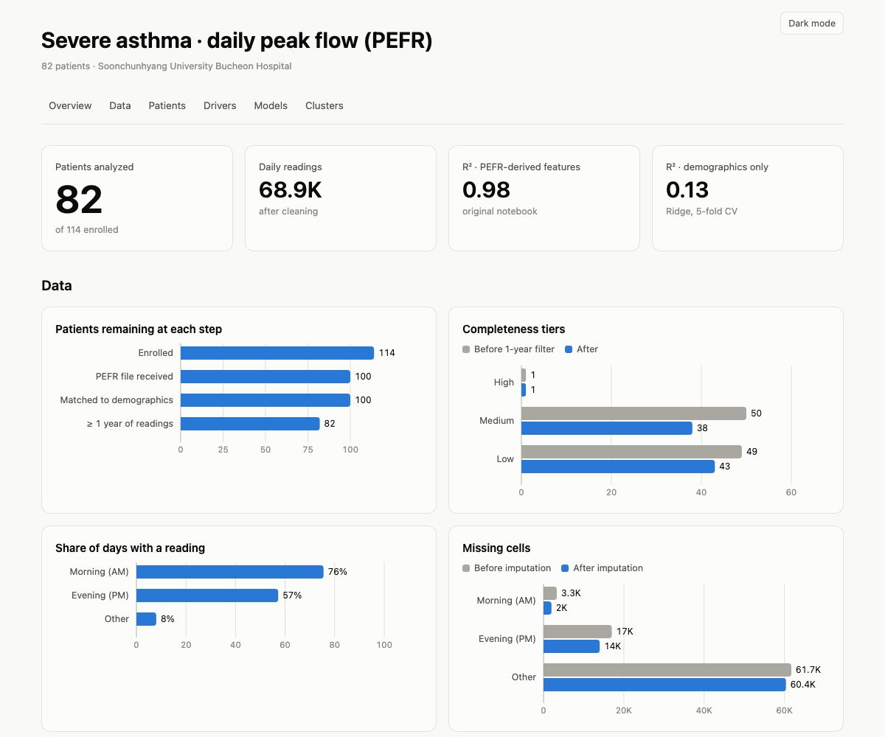

# Clustering Asthma Patients by Peak-Flow Patterns

Can a patient's demographics predict how well they breathe? This project cleans roughly 69,000 days of home peak expiratory flow rate (PEFR) readings from 114 severe-asthma patients. It summarizes each patient, builds regression models of mean morning PEFR, and clusters patients by the strength and stability of their breathing.

**Stack:** Python · pandas · NumPy · scikit-learn · Matplotlib · HTML/SVG dashboard

**[View the live dashboard →](https://mellifluous-quokka-d2218e.netlify.app/)**

[](https://mellifluous-quokka-d2218e.netlify.app/)

The dashboard source is [`dashboard/index.html`](dashboard/index.html), a single file with no dependencies.

## Key results

| | |
|---|---|
| Patients after cleaning | **82** of 114 (at least 1 year of readings) |
| Strongest demographic predictor | **Height**, Spearman ρ = 0.63 with mean AM PEFR |
| Demographics-only model | **R² = 0.13 ± 0.43** (Ridge, 5-fold CV × 20 repeats) |
| Clusters | 4 groups from mean PEFR and day-to-day variability (silhouette 0.40) |

- Morning readings are the most complete signal: 76% of days have one, compared with 57% for evening and 8% for "other". All modeling therefore uses AM PEFR.
- Patients in the high and stable PEFR cluster are on average 9 cm taller than the rest. Body size drives most of the between-patient difference.
- Demographics alone explain only a small share of peak flow. Treatment, season and exacerbation history are the likely missing drivers.

## Pipeline

Run the scripts in order from the repository root:

| Step | Script | What it does |
|---|---|---|
| 1 | [`src/read_files.py`](src/read_files.py) | Reads the per-patient Excel files, extracts IDs and matches them to demographics |
| 2 | [`src/update_patient_with_completeness.py`](src/update_patient_with_completeness.py) | Sorts patients into high, medium or low data-completeness tiers |
| 3 | [`src/year_long_script.py`](src/year_long_script.py) | Keeps patients whose readings span at least one year and drops empty dates |
| 4 | [`src/handle_missing_data.py`](src/handle_missing_data.py) | Removes all-blank and all-zero rows and marks remaining gaps |
| 5 | [`src/imputing_data.py`](src/imputing_data.py) | Treats values above 1,000 as errors; forward-fills short gaps and interpolates long ones |
| 6 | [`src/statistical.py`](src/statistical.py) | Computes per-patient count, min, median, max, mean, std and skew |
| 7 | [`notebooks/`](notebooks/) | Linear, Ridge and Lasso regression with K-fold cross-validation |
| 8 | [`analysis/build_dashboard.py`](analysis/build_dashboard.py) | Re-evaluates the models, clusters patients and writes the dashboard |

```bash
pip install -r requirements.txt
python src/read_files.py
python src/update_patient_with_completeness.py
python src/year_long_script.py
python src/handle_missing_data.py
python src/imputing_data.py
python src/statistical.py
python analysis/build_dashboard.py
```

## Modeling

**Models compared.** Linear regression is the interpretable baseline. Ridge (L2) handles the strong overlap between height, weight, BMI and body surface area. Lasso (L1) adds feature selection. K-fold cross-validation replaces a single train/test split, because 82 patients make any one split noisy.

**Lesson learned: target leakage.** The first regression reported R² ≈ 0.98. Its features included `pefr_median`, `pefr_min`, `pefr_max` and `pefr_sum`, which are all computed from the same readings as the target `pefr_mean`. A model using `pefr_median` alone scores R² = 0.995. Re-evaluated with demographic features only, the honest R² is about 0.13. That result became the project's real finding: height matters, and the rest of the signal lies outside the demographic data.

| Model | PEFR-derived features | Demographics only |
|---|---:|---:|
| Linear | 0.99 | -0.02 |
| Ridge | 0.95 | 0.13 |
| Lasso | 0.99 | 0.09 |
| Random forest | 0.95 | 0.06 |
| Predict the average | | -0.09 |

*Mean R² over 5-fold cross-validation repeated 20 times.*

## Next steps

- Use percent-predicted PEFR (adjusted for age, sex and height) to separate disease severity from body size.
- Base completeness tiers on the AM column, and measure gap length in calendar days rather than rows.
- Check cluster stability with bootstrap re-clustering, then train a classifier to predict cluster membership.

## Repository structure

```
├── src/                 data cleaning and summary pipeline
├── notebooks/           regression modeling and cross-validation
├── analysis/            model re-evaluation, clustering, dashboard build
├── dashboard/           interactive HTML dashboard (index.html) and its template
├── docs/                proposal, final report, presentation slides
├── data_org/            source data from the hospital
└── data_read/           processed outputs
```

## Documents

- [Project proposal](docs/proposal.pdf)
- [Final report](docs/final_report.pdf)
- [Presentation slides](docs/presentation.pdf)

## Team

A collaborative project by **Camy Ngo** and **Rena Ahn** for MSCS 5305 (Group 4). Group repository: [mscs5305-group4/clustering-patients](https://github.com/mscs5305-group4/clustering-patients).

Data provided by the Division of Allergy and Respiratory Medicine, Soonchunhyang University Bucheon Hospital, South Korea.
